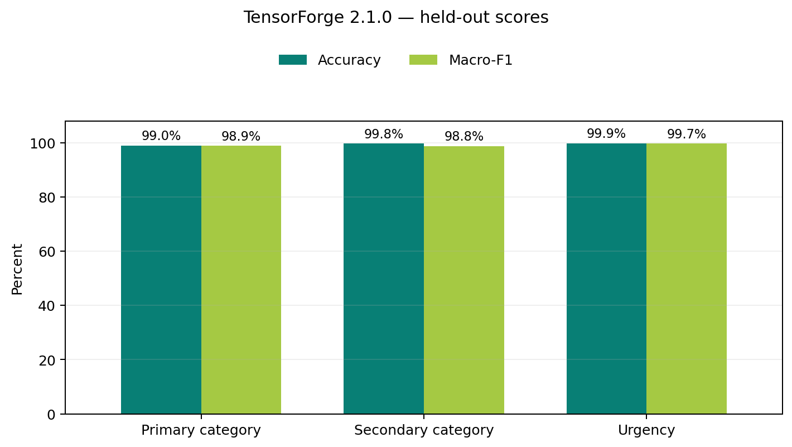
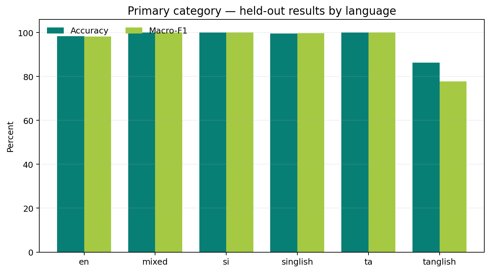
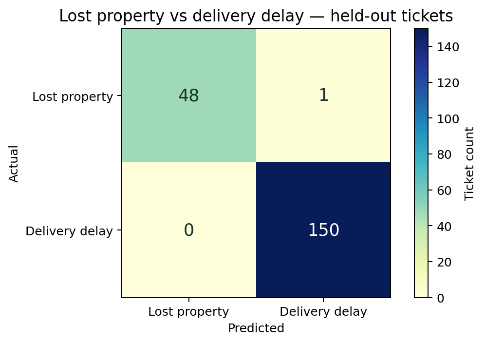
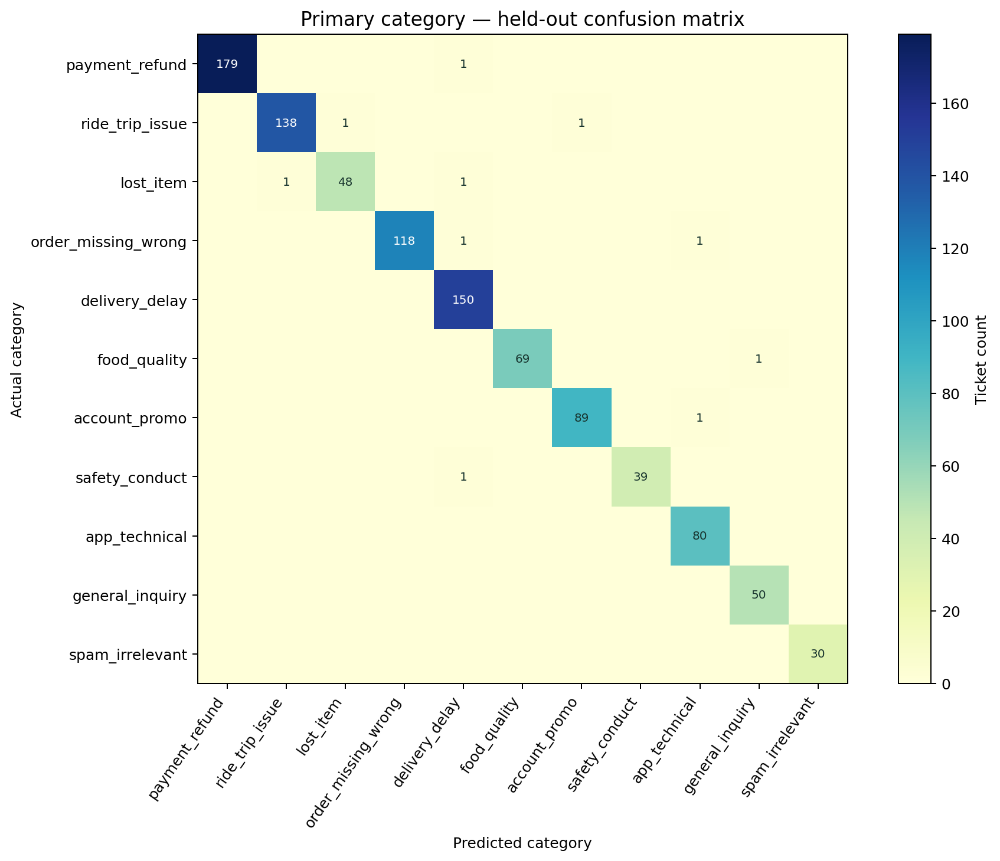

# ResolveX × TensorForge — Support Intelligence

A multilingual RideEat support-ticket classifier, API, and React dashboard adapted from your ResolveX system. Ticket intake, live operations, support review, batch inference, and a model lab share the same trained backend. The classifier is a locally trained TF-IDF models (logistic regression and a calibrated linear SVM); predictions do not call an LLM or any external service.

## Start the full app with one command

Install Docker Desktop (macOS/Windows) or Docker Engine with Compose (Linux), then run this from the repository root:

```bash
docker compose up --build -d
```

This starts the dashboard and API together with a persistent PostgreSQL database. By default, the app is available at <http://localhost:8080> and PostgreSQL at `localhost:5433`; these ports avoid common local development services already using 8000 or 5432. Check readiness at <http://localhost:8080/health>. The first build can take a few minutes. Stop the app with `docker compose down`; database records remain in the Compose volume. `docker compose down -v` also deletes the stored database.

To choose other host ports, set `APP_PORT` and `POSTGRES_PORT`, for example: `APP_PORT=18000 POSTGRES_PORT=15432 docker compose up --build -d`.

Compose uses development-only defaults for `API_KEY` and `SUPPORT_PASSWORD`; its local Postgres credentials are `tensorforge` / `tensorforge-local-dev`. Override the API key and support password before starting if needed:

```bash
API_KEY='your-local-key' SUPPORT_PASSWORD='your-local-support-password' docker compose up --build -d
```

For a local-only demo, the API key is `local-development-key` and support login password is `local-support-password`. Never expose this development stack to the public internet with default credentials. The Postgres service is only published on `127.0.0.1:5432`.

The batch workbench can seed sample tickets into the database: open **Batch workbench**, choose **Load sample**, then **Run batch**. These synthetic demo records persist across app restarts.

## Manual local setup (without Docker)

Python 3.10+ is supported locally; Vercel runs Python 3.12. Install dependencies, train the bundled workshop data, then start the service:

```bash
python -m venv .venv
source .venv/bin/activate
pip install -r requirements.txt
pip install -r requirements-dev.txt
python scripts/train_model.py
npm ci --prefix frontend
npm run build --prefix frontend
uvicorn app.main:app --host 0.0.0.0 --port 8000
```

For local development, put `API_KEY` in `.env`. It is loaded automatically, ignored by Git, and excluded from the Docker build. Deployment environment variables take precedence over values in `.env`.

Open <http://localhost:8000> for the dashboard or <http://localhost:8000/docs> for the API explorer. `GET /health` is public. All inference and batch-job endpoints return `401` until `API_KEY` is set, and accept either `X-API-Key` or `Authorization: Bearer <your-team-key>`. The API never has a default key. The dashboard automatically uses the configured server key through its same-origin demo bridge. The key is never returned to the browser or saved in browser storage.

The organizer’s supplied OpenAPI v2.1.0 contract is saved in `tensorforge-phase2-openapi-v2.yaml`. `/openapi.json` and `/docs` use the matching `app/openapi.json`, which is bundled in the container. The API specification version is independent of the trained model version.

## Docker images for macOS and other platforms

Every push to `main` publishes `ghcr.io/geemalfernando/tensorforge-phase2:latest`; version tags publish matching version tags. GitHub Actions builds `linux/amd64` and `linux/arm64` images, so Docker Desktop selects the compatible image for Intel and Apple Silicon Macs. The image includes the trained model artifact; no training data or model download is needed at runtime.

```bash
docker pull ghcr.io/geemalfernando/tensorforge-phase2:latest
```

The published app container serves the frontend and API together. For a full local stack including its own persistent Postgres database, use the Compose command above. To use an external database, configure `DATABASE_URL` with a PostgreSQL connection string. Keep API keys and database credentials out of source control.

## API

| Method | Path | Purpose |
| --- | --- | --- |
| `GET` | `/health` | Public readiness and loaded model version |
| `POST` | `/auth/verify` | Verify API access without submitting a ticket |
| `POST` | `/predict` | Classify one ticket |
| `POST` | `/predict/batch` | Classify 1–100 tickets synchronously |
| `POST` | `/batch/jobs` | Queue 1–5,000 tickets for async classification |
| `GET` | `/batch/jobs/{job_id}` | Poll job status and progress |
| `GET` | `/batch/jobs/{job_id}/results` | Fetch stable, pageable results after success |
| `DELETE` | `/batch/jobs/{job_id}` | Cancel or discard a job |

### Dashboard workflows

The ResolveX-style workspace has five views: Ticket intake, Live operations, Support queue, Batch workbench, and Model lab. Intake supports chat, email subject/body, and call transcripts. Predictions enter the current browser session queue. Urgent and low-confidence tickets enter support review; an agent can confirm the team or record a routing override with a reason. Review decisions are session demo state, reset on refresh, and leave canonical model predictions unchanged.

The batch workbench accepts JSON so a dataset can be pasted or uploaded as one portable, predictable payload with a unique `ticket_id`, `channel`, and `text` for each ticket (with optional `subject` or `language`). The API validates the batch, preserves input order, and returns matching predictions. It processes 1–100 tickets synchronously or 101–5,000 asynchronously, polls progress, supports cancellation, and downloads all results. Its preview shows up to 100 rows. The model lab reads actual loaded classifier classes and saved validation metrics from the server.

The dashboard is responsive down to 320px: workspace navigation scrolls horizontally on touch screens, and primary actions keep touch-friendly targets. The main views were checked at 320, 360, 390, 430, 768, and 1024px.

The browser calls `/dashboard/api/...`; the server supplies its configured key internally. There is no API-key prompt or browser secret. Direct judging routes require the exact evaluation key. See [ResolveX adaptation details](docs/resolvex-adaptation.md) for source provenance and the three-model replacement.

For frontend development, run `npm run dev --prefix frontend` alongside the API, and open the URL printed by Vite. Rebuild with `npm run build --prefix frontend` to update the UI served by FastAPI. Node is needed only to build the UI; Docker handles this in its build stage.

For a single-project deployment of the dashboard and API on Vercel with Supabase PostgreSQL and Vercel Queues, follow the [Vercel + Supabase deployment guide](deploy/vercel-supabase/README.md).

Request examples:

```bash
curl http://localhost:8000/predict \
  -H 'Content-Type: application/json' \
  -H 'X-API-Key: your-team-key' \
  -d '{"ticket_id":"TF-1048","channel":"chat","text":"mage order eka late, refund ekak denna"}'

curl http://localhost:8000/predict/batch \
  -H 'Content-Type: application/json' \
  -H 'X-API-Key: your-team-key' \
  -d '{"tickets":[{"ticket_id":"TF-1048","channel":"chat","text":"Order is late"}]}'
```

The API validates the full batch before returning any predictions, preserves input order, echoes ticket IDs, and returns JSON errors for malformed, invalid, oversized, unauthorized, and unknown-route requests. Async jobs accept 1–5,000 tickets and support idempotency keys, a one-running-plus-three-queued limit, persisted status/results, cancellation, restart marking, and 24-hour result retention (above the contract’s six-hour minimum). Deleting a queued/running job retains its `cancelled` status; deleting a finished job discards it.

### Postman

`postman/` holds a judge-style collection plus `TensorForge Local` and `TensorForge Hosted` environments. Import all three, pick an environment, set `api_key` (a secret variable, left empty in the files), and run the collection with the Collection Runner. It covers public `/health`; correct, wrong, and missing keys through `X-API-Key` and `Authorization: Bearer`; 400/404/415/422 errors; 1–100 ticket batches; and a 2,500-ticket async job through submit, idempotent resubmit, polling, paged results, 404, and delete. A collection-level test checks every returned prediction against the fixed category→team table and the consistency rules. The same run works from the command line:

```bash
npx newman run postman/TensorForge.postman_collection.json \
  -e postman/TensorForge-Local.postman_environment.json --env-var api_key="$API_KEY"
```

## Model and evaluation

Training uses `channel`, optional `language`, `subject`, and `text`; ticket IDs are excluded. The language hint is optional at inference, and the classifier also works when it is absent. The Drive archive was downloaded and verified against the local files: it contains 4,000 synthetic training tickets and 800 development validation tickets. Checksums and source details are recorded in `datasets/source_manifest.json`.

All three classifiers were retrained from the labeled tickets. The active artifact is `tf-phase2-drive-2.1.0`: primary category uses balanced logistic regression (`C=100`, word 1–2 and boundary-aware character 2–6 grams); secondary category uses a three-fold sigmoid-calibrated linear SVM (`C=1`); urgency uses balanced logistic regression (`C=40`). Secondary and urgency cutoffs are 0.2 and 0.3. Secondary/urgency text cleanup normalizes whitespace and removes explicitly quoted historical correspondence and synthetic reference IDs. Fixed routing and narrow precedence rules enforce the competition policy.

```bash
python scripts/train_model.py
# Optional reproduction of primary-model development comparisons:
python scripts/compare_training.py --target category
```

`scripts/train_model.py` makes a deterministic, category-stratified 75/25 split of `datasets/train.csv` (3,000 fit / 1,000 test examples), reports the untouched test-fold scores, then refits the deployable artifact on all 4,800 labeled tickets. It writes the split metadata and scores to `artifacts/evaluation_metrics.json` and `artifacts/evaluation_breakdown.json`. The executed notebooks [retrain_75_25.ipynb](notebooks/retrain_75_25.ipynb) and [final_model_release.ipynb](notebooks/final_model_release.ipynb) include the evaluation, model rationale, per-class/per-language diagnostics, visual confusion matrices, and delivery-delay/lost-property checks. `configs/training.json` freezes the selected configuration and thresholds.

Regenerate the README figures from those saved metrics with `python scripts/export_release_visuals.py`.

### Final model release: `tf-phase2-drive-2.1.0`

The evaluation uses an untouched, stratified **25% test fold from `train.csv`** (3,000 fit / 1,000 test, seed 42). The supplied validation CSV is not used to produce these scores; after evaluation, the deployable model is refit on all 4,800 labeled tickets.

| Prediction target | Accuracy | Macro-F1 |
| --- | ---: | ---: |
| Primary category | **99.00%** | **98.92%** |
| Secondary category | **99.80%** | **98.84%** |
| Urgency | **99.90%** | **99.71%** |



Primary-category accuracy by language: English **98.31%** (356 tickets), mixed **100.00%** (23), Sinhala **100.00%** (198), Singlish **99.61%** (255), Tamil **100.00%** (146), and Tanglish **86.36%** (22). The smaller language groups have substantial uncertainty.



On the held-out fold, **150/150** delivery-delay tickets were routed correctly, with **0** routed to Lost & Found. Of 50 personal lost-property tickets, 48 were classified correctly and one was predicted as delivery delay.





The complete [final model release notebook](notebooks/final_model_release.ipynb) documents all class-level precision, recall, F1, support, confusion matrices, model rationale, and limitations. These scores measure synthetic workshop examples only; they do not guarantee performance on real customer messages or judge-provided tickets.

Primary confidence below 0.5 or a message with three or fewer words recommends human review. Ambiguous messages such as `badu nati una` still require clarification about whether personal belongings or food-order contents are missing. Review decisions never alter the raw API prediction. Primary confidence has not been independently calibrated.

## Phase 2 submission

Track verified requirements and missing evidence in [the submission checklist](docs/submission-checklist.md). A [report draft](docs/report.md) and [15-minute video outline](docs/video-walkthrough.md) are available. Contract tests validate responses against the supplied OpenAPI’s embedded schemas and check its prose consistency rules. OpenAPI 3.0 `nullable` is translated for the JSON Schema validator. The exact organizer draft-2020-12 schemas downloaded from Drive are in `schemas/`; contract tests also validate responses against that bundle. Public hosting and video recording are separate deliverables.

## Tests

```bash
pytest -q
```

Browser workflow verification (against a running local service):

```bash
npx --prefix frontend playwright install chromium
BASE_URL=http://127.0.0.1:8000 node scripts/verify_dashboard.cjs
```

This checks intake, review, urgent routing, single/synchronous/2,001-ticket async inference, ordered download, three-model status, and mobile layout.

The 33 tests include validation against the supplied OpenAPI's embedded schemas and consistency rules. Reproduce container checks with:

```bash
docker build -t tensorforge-mvp .
python scripts/verify_container.py --image tensorforge-mvp
```

The verification script loads `.env`, checks published-port readiness within 120 seconds, then runs inference, a 100-ticket batch, and a 2,001-ticket job in a separate container with `--network none`. It removes its temporary containers and never prints the API key. Saved local evidence is in `artifacts/container_verification.json` and `artifacts/contract_job_verification.json`; these are development-machine results, not reference-hardware or hosted measurements.
