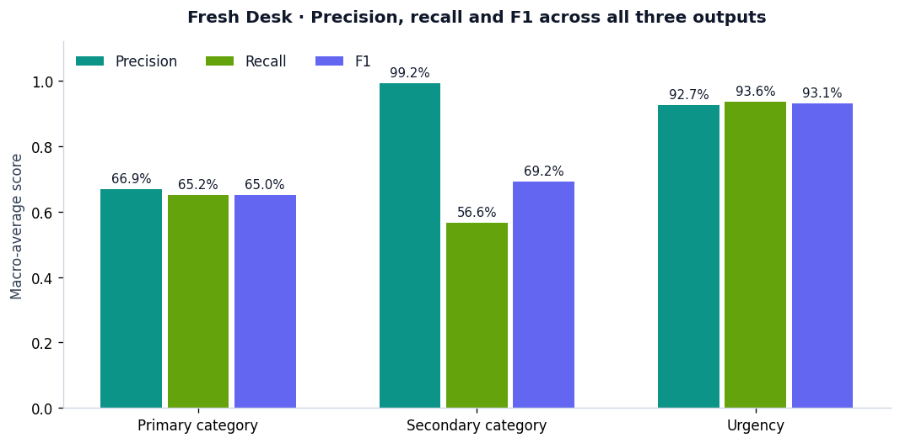
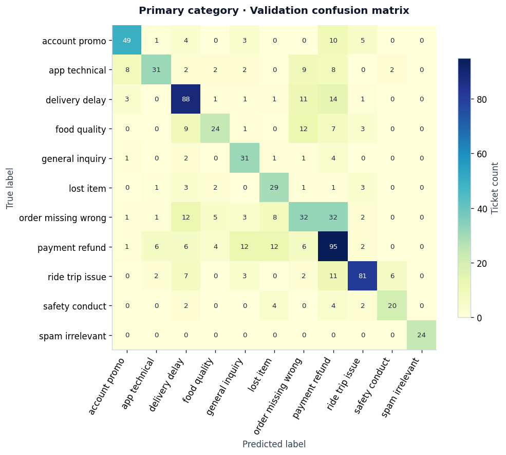
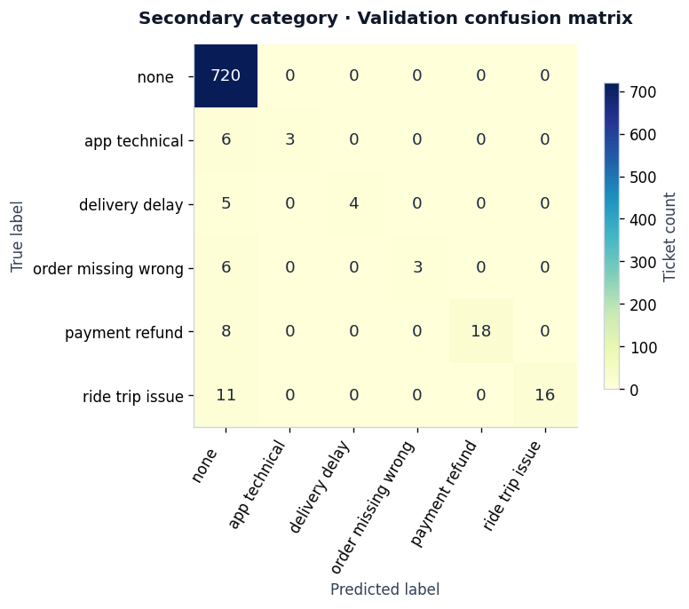
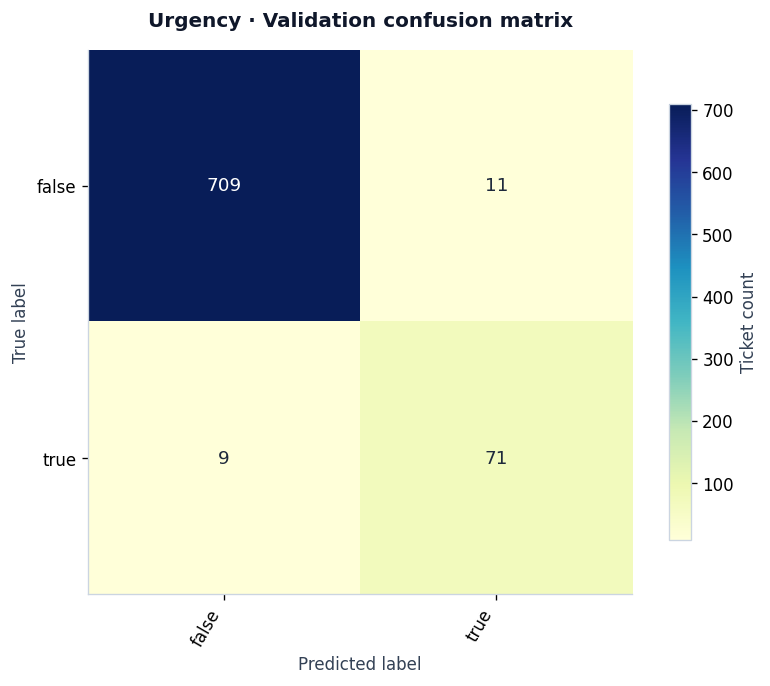
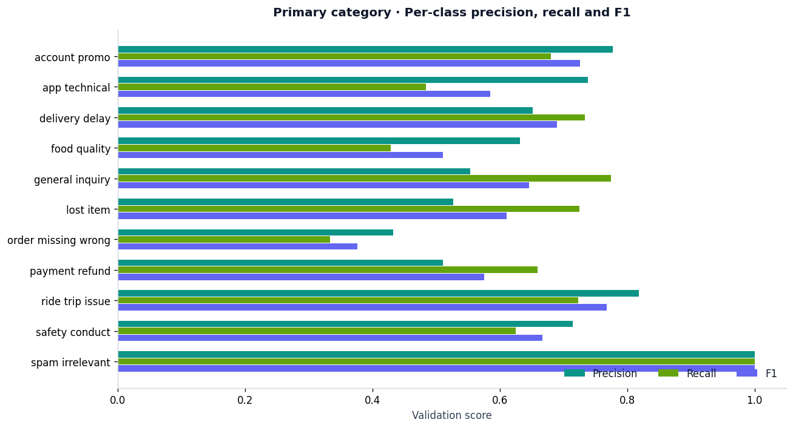
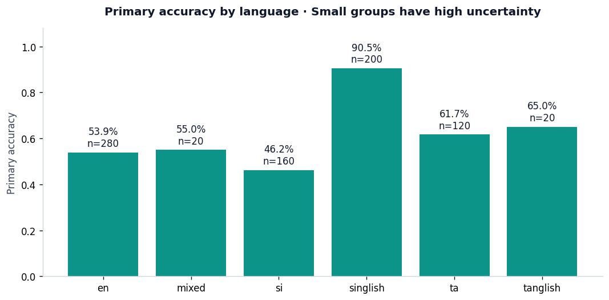
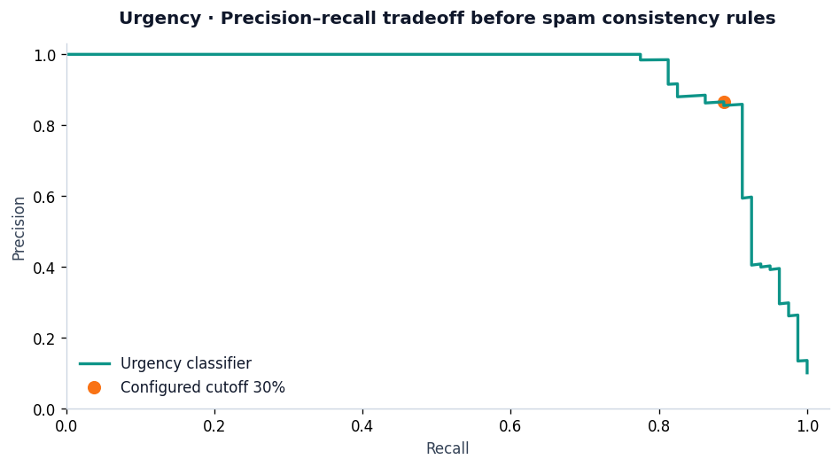

# Fresh Desk — Model analytics

Active artifact: `tf-phase2-drive-2.0.0`. Evaluated on **800** supplied validation tickets; all predictions pass the organizer JSON Schema.

These are **development scores**. This validation split informed model configuration and thresholds. It is not an independent test set or evidence of real-world accuracy. Data are synthetic; native-script quality has not been independently reviewed.

## Overall results

| Model output | Accuracy | Macro precision | Macro recall | Macro F1 | Weighted precision | Weighted recall | Weighted F1 |
| --- | ---: | ---: | ---: | ---: | ---: | ---: | ---: |
| Primary category | 63.00% | 66.87% | 65.16% | 65.04% | 64.20% | 63.00% | 62.72% |
| Secondary category | 95.50% | 99.21% | 56.60% | 69.22% | 95.71% | 95.50% | 94.79% |
| Urgency | 97.50% | 92.67% | 93.61% | 93.13% | 97.53% | 97.50% | 97.51% |



## Training and inference details

| Output | Estimator | C | Class weights | Character n-grams | Decision cutoff |
| --- | --- | ---: | --- | --- | --- |
| Primary category | logistic_regression | 100 | balanced | char_wb [2, 6] | Highest primary probability |
| Secondary category | calibrated_svm | 1.0 | None | char [2, 6] | 0.2 |
| Urgency | logistic_regression | 40 | balanced | char [2, 5] | 0.3 |

Word TF-IDF uses 1–2 grams. Training uses channel, subject and text; excludes ticket IDs and language labels. Secondary uses a three-fold sigmoid-calibrated linear SVM; primary and urgency use logistic regression. Primary probabilities have not been independently calibrated. Narrow category precedence and spam consistency rules are applied after model scoring.

## Per-class scores for every trained output

### Primary category

| Label | Precision | Recall | F1 | Support |
| --- | ---: | ---: | ---: | ---: |
| account_promo | 77.78% | 68.06% | 72.59% | 72 |
| app_technical | 73.81% | 48.44% | 58.49% | 64 |
| delivery_delay | 65.19% | 73.33% | 69.02% | 120 |
| food_quality | 63.16% | 42.86% | 51.06% | 56 |
| general_inquiry | 55.36% | 77.50% | 64.58% | 40 |
| lost_item | 52.73% | 72.50% | 61.05% | 40 |
| order_missing_wrong | 43.24% | 33.33% | 37.65% | 96 |
| payment_refund | 51.08% | 65.97% | 57.58% | 144 |
| ride_trip_issue | 81.82% | 72.32% | 76.78% | 112 |
| safety_conduct | 71.43% | 62.50% | 66.67% | 32 |
| spam_irrelevant | 100.00% | 100.00% | 100.00% | 24 |
| macro avg | 66.87% | 65.16% | 65.04% | 800 |
| weighted avg | 64.20% | 63.00% | 62.72% | 800 |



### Secondary category

| Label | Precision | Recall | F1 | Support |
| --- | ---: | ---: | ---: | ---: |
| __none__ | 95.24% | 100.00% | 97.56% | 720 |
| app_technical | 100.00% | 33.33% | 50.00% | 9 |
| delivery_delay | 100.00% | 44.44% | 61.54% | 9 |
| order_missing_wrong | 100.00% | 33.33% | 50.00% | 9 |
| payment_refund | 100.00% | 69.23% | 81.82% | 26 |
| ride_trip_issue | 100.00% | 59.26% | 74.42% | 27 |
| macro avg | 99.21% | 56.60% | 69.22% | 800 |
| weighted avg | 95.71% | 95.50% | 94.79% | 800 |



### Urgency

| Label | Precision | Recall | F1 | Support |
| --- | ---: | ---: | ---: | ---: |
| false | 98.75% | 98.47% | 98.61% | 720 |
| true | 86.59% | 88.75% | 87.65% | 80 |
| macro avg | 92.67% | 93.61% | 93.13% | 800 |
| weighted avg | 97.53% | 97.50% | 97.51% | 800 |





## Language breakdown

| Language | Tickets | Primary accuracy | Macro F1 |
| --- | ---: | ---: | ---: |
| en | 280 | 53.93% | 58.49% |
| mixed | 20 | 55.00% | 36.99% |
| si | 160 | 46.25% | 49.24% |
| singlish | 200 | 90.50% | 90.98% |
| ta | 120 | 61.67% | 57.12% |
| tanglish | 20 | 65.00% | 56.10% |



## Urgency threshold

The configured urgency cutoff is 30%. The following curve shows the classifier probability tradeoff before the API forces spam to nonurgent. Classification tables above score the final API outputs.



## Review and acceptance

485 of 800 validation predictions recommend human review. The dashboard also sends urgent tickets to the support queue. A message with three or fewer words or primary confidence below 50% requires review. Only an authenticated support role can accept a ticket or override its team, with an explanation required for an override. Raw predictions remain unchanged; the accepted team and support audit entry are stored separately.

## Reproduce

```bash
python scripts/model_analytics.py
python scripts/build_model_analytics.py --execute
```

See [the executed Jupyter notebook](../notebooks/model_analytics.ipynb), [frozen training settings](../configs/training.json), and [saved experiments](../artifacts/training_experiments.json). PNG and SVG figures are exported in `docs/analytics/`.
