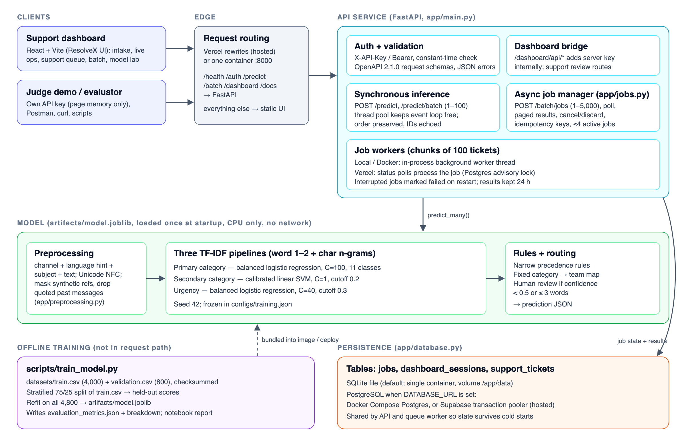
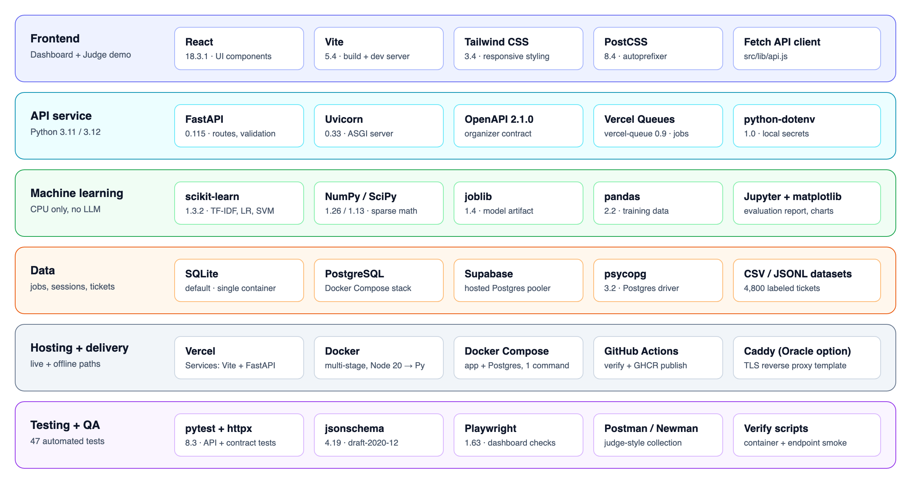

# TensorForge 2.0 — Phase 2 Report

**Team:** TF-T03 · Byte Benders  
**Live demo:** <https://tensorforge-phase2.vercel.app/> · **API docs:** <https://tensorforge-phase2.vercel.app/docs>  
**Model artifact:** `tf-phase2-drive-2.1.0` · **API contract:** OpenAPI 2.1.0 (organizer-supplied)  
**Report updated:** 10 October 2026

## 1. Problem and solution

RideEat support messages arrive by chat, email, and call transcript. They are written in English, Sinhala, Tamil, transliterated Singlish/Tanglish, and mixed scripts. For each ticket, our system predicts:

- a primary issue category (11 classes),
- an optional secondary issue,
- whether the ticket is urgent,
- the responsible support team.

Predictions are served through an authenticated evaluation API and a React support dashboard adapted from our ResolveX system. The dashboard covers ticket intake, live operations, the support review queue, the batch workbench, the model lab, and the Judge demo.

Classification uses locally trained TF-IDF pipelines with logistic regression and a calibrated linear SVM. At runtime there is no LLM, no remote model, no model download, and no paid inference API. The evaluation API key authenticates callers to our own service; it is not a model-provider credential.

## 2. System architecture

**Clients.** The dashboard calls a same-origin bridge (`/dashboard/api/...`), and the server adds its configured key internally, so the key never reaches the browser. The Judge demo asks the evaluator to enter their own key and verifies it with `POST /auth/verify`. The key is kept in page memory only and is cleared on sign-out. Postman, curl, and our scripts call the evaluation API directly.

**Routing.** The hosted deployment is one Vercel project with two services. Rewrites send `/health`, `/auth`, `/predict`, `/batch`, `/dashboard`, and `/docs` to FastAPI, and all other paths to the static Vite build. The Docker image serves both from one process on port 8000.

**API layer** (`app/main.py`). Protected routes accept `X-API-Key` or `Authorization: Bearer`, and the key is compared in constant time. If no key is configured, protected access is denied. Requests are validated against the supplied contract before inference, and errors use the specified JSON format. `/predict` and `/predict/batch` (1–100 tickets) run CPU-bound inference in a thread pool so the event loop stays free. Batch output keeps the input order and echoes ticket IDs.

**Async jobs** (`app/jobs.py`). `POST /batch/jobs` accepts 1–5,000 tickets and enforces a 25 MB request limit. Jobs support:

- idempotency keys,
- a limit of four active jobs, with a retryable error when the queue is full,
- status polling and pageable results,
- cancellation and discard,
- 24-hour result retention.

Jobs are processed in chunks of 100 tickets. Locally and in Docker, an in-process background worker does this work. On Vercel, which has no long-lived worker, the status and results polls process the job under a Postgres advisory lock (see section 5). Jobs interrupted by a restart are marked failed.

**Model** (`artifacts/model.joblib`). The model is loaded once at startup. Preprocessing builds features from the channel, the optional language hint, the subject, and the text. It applies Unicode NFC normalization, masks synthetic reference IDs, and strips quoted past correspondence. Three pipelines then predict the primary category, the secondary category, and urgency. Narrow precedence rules and a fixed category→team map produce the final, contract-shaped prediction.

**Persistence** (`app/database.py`). Three tables (`jobs`, `dashboard_sessions`, `support_tickets`) live in SQLite by default. When `DATABASE_URL` is set, PostgreSQL is used instead: Docker Compose locally, or the Supabase transaction pooler when hosted. The API and the queue worker share the same database, so job state survives cold starts.

**Packaging.** A multi-stage Dockerfile builds the React UI in a Node stage. It then copies the compiled UI, the trained artifact, and the OpenAPI document into a Python image. `.env` is excluded from the image. `docker run -p 8000:8000 -e API_KEY ... tensorforge-mvp` starts the full system. `docker compose up` adds a persistent Postgres database.

**Technology stack.** Each layer of the system uses the following technologies. Versions are pinned in `requirements.txt` and `frontend/package.json`.

## 3. Training and development

The organizer dataset has 4,000 training and 800 validation tickets. We downloaded it from Drive and verified it against our local copy; checksums are recorded in `datasets/source_manifest.json`. Ticket IDs are excluded from the features, and the language hint is optional at inference. Word 1–2 grams capture lexical phrases. Character n-grams handle different scripts, spelling variants, and transliteration.

| Target | Estimator | Key settings |
| --- | --- | --- |
| Primary category | Logistic regression, balanced | `C=100`, word 1–2 + boundary-aware char 2–6 grams |
| Secondary category | Linear SVM, 3-fold sigmoid calibration | `C=1`, char 2–6 grams, cutoff 0.2 |
| Urgency | Logistic regression, balanced | `C=40`, char 2–5 grams, cutoff 0.3 |

All pipelines use seed 42, and the selected settings are frozen in `configs/training.json`. One early candidate was selected on an internal split, but it reduced validation category accuracy to 60.88%, so we rejected it. All development comparisons are kept in `artifacts/training_experiments.json`.

`python scripts/train_model.py` reproduces the full training run:

1. It makes a deterministic split of `train.csv`, stratified by category: 75% for fitting (3,000) and 25% held out for testing (1,000).
2. It scores the held-out fold. `validation.csv` is never used for this test score.
3. It refits the deployable artifact on all 4,800 labeled tickets.

The notebook `notebooks/tensorforge_model_report.ipynb` (PDF: `docs/tensorforge-model-report.pdf`) shows per-class metrics, language breakdowns, and confusion matrices.

## 4. Evaluation and findings

Held-out 25% test fold of `train.csv` (1,000 tickets):

| Output | Accuracy | Macro-F1 |
| --- | ---: | ---: |
| Primary category | 99.00% | 98.92% |
| Secondary category | 99.80% | 98.84% |
| Urgency | 99.90% | 99.71% |

**Delivery delay vs. lost property.** All 150 `delivery_delay` tickets were classified correctly, and none was routed to Lost & Found. Of the 50 `lost_item` tickets, 48 were correct and one was predicted as `delivery_delay`.

**Primary-category accuracy by language:**

| Language | Accuracy | Tickets |
| --- | ---: | ---: |
| English | 98.31% | 356 |
| Mixed | 100% | 23 |
| Sinhala | 100% | 198 |
| Singlish | 99.61% | 255 |
| Tamil | 100% | 146 |
| Tanglish | 86.36% | 22 |

The mixed and Tanglish groups are small, so these figures are highly uncertain.

**Human review.** The system recommends human review when primary confidence is below 0.5 or the message has three or fewer words. Confidence is the model probability for the returned label, including after a rule override, and it is not independently calibrated.

**Tests.** The automated suite has 47 tests. They cover:

- authentication on protected routes,
- input errors and output structure,
- issue precedence and result ordering,
- idempotency, job status, pagination, and deletion,
- contract validation against the supplied OpenAPI schemas and the organizer's draft-2020-12 JSON Schemas.

On 10 October 2026, 46 tests passed locally. The one remaining test needs the Vercel Queue SDK, which is not installed in the local Python 3.8 environment. A Postman collection (`postman/`) repeats the judge-style checks against either the local or the hosted environment.

**Limitations.** These scores come from synthetic workshop data. The judges' unseen holdout is the independent evaluation. Sinhala and Tamil content has not been reviewed by native speakers, and ambiguous short messages (for example, "badu nati una") still need clarification.

## 5. Deployment and verification evidence

| Check | Result |
| --- | --- |
| Public `/health` (10 Oct 2026) | `ok`, model `tf-phase2-drive-2.1.0` loaded |
| Missing key on `/predict` and `/predict/batch` | HTTP 401 |
| Valid key: `/predict` and `/predict/batch` | Passed on the public host |
| Hosted async jobs, 2,001 and 5,000 tickets | Passed with ordered results (10 Oct 2026); 5,000 tickets finished on the first status poll |
| Local async jobs | 5,000 tickets with ordered results; health and live predictions stayed responsive |
| Offline container (`--network none`) | Health ready in 1.414 s; 100-ticket sync and 2,001-ticket async jobs passed |

We ran the container checks on Docker Desktop, not on the organizers' reference hardware.

**Hosted job processing.** The first hosted check found that Vercel deployed no queue consumer, so jobs stayed queued and filled the four-job limit. Hosted jobs are now processed by the status polls that the contract already requires. A Postgres advisory lock stops two polls from processing the same job, and a full queue is drained before a submission is rejected. Local and Docker deployments still use the background worker.

**Remaining before final submission:**

1. Keep the exact evaluation key active throughout judging.
2. Grant judges access to the private GitHub repository.
3. Upload the refreshed 15-minute walkthrough as an unlisted YouTube video.

Evidence and final links are tracked in `docs/submission-checklist.md`.
